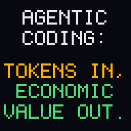
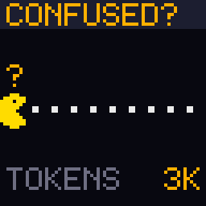
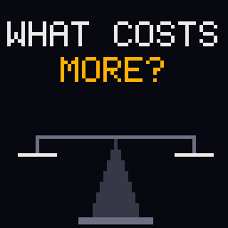
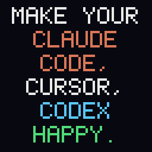
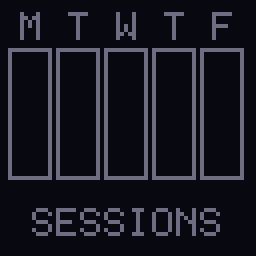
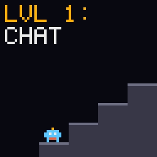
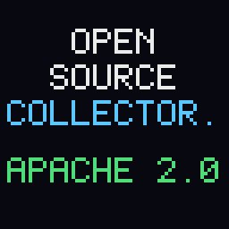
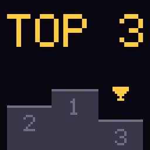
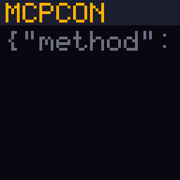

# AGNTCon + MCPCon North America 2026: Quesma booth scenes

Event: [AGNTCon + MCPCon North America](https://events.linuxfoundation.org/agntcon-mcpcon-north-america/), Linux Foundation / Agentic AI Foundation, 22-23 Oct 2026, San Jose McEnery Convention Center. Audience: people building, evaluating and operating agents, plus the MCP crowd. Open-source friendly.

Frame: maximize the economic value of agentic coding through insights from session transcripts. Every scene is one angle on that; each ends with a different "talk to me" card. Tone as in [Founder House Stockholm](../founder_house_stockholm/README.md): nerdy wink, never a dig at a tool, lab or person, no URL or QR on screen. The name `QUESMA` appears only on the last card of `value`.

Display: 64x64, 5x7 font, max 10 characters per line, up to 6 lines under a header. Text cards stay up 5.5-7 s, animation steps about 0.8 s. One upload holds at most 255 chunks (about 50 KB), so the full set will not fit in one playlist.

Previews below are upscaled 4x; the device gets the 64x64 version.

```bash
uv run scripts/agntcon_mcpcon_na.py --list       # playlists, loop length, chunks
uv run scripts/agntcon_mcpcon_na.py main         # send the playlist (or a single scene name)
uv run scripts/agntcon_mcpcon_na.py --preview    # regenerate the scene GIFs below
```

## 1. value (frame, 58 s)



The thesis card. A tokens-in, value-out meter.

1. `AGENTIC` / `CODING:` / `TOKENS IN,` / `ECONOMIC` / `VALUE OUT.`
2. Two bars: `TOKENS` (orange) grows fast; `ECONOMIC` (green) grows slowly, then stalls. `HMM.` blinks.
3. `WHERE DID` / `THE TOKENS` / `GO?`
4. A scroll of transcript lines flies past (`$ ls`, `$ cat`, `$ ls`, `$ cat`, ...), a magnifier sweeps across it.
5. `THE ANSWER` / `IS IN THE` / `TRANSCRIPT`
6. Bars again: `ECONOMIC` catches up with `TOKENS`, then `MAX` / `ECONOMIC` / `VALUE` / `PER TOKEN.`
7. Closer: `HOW? ASK` / `THE HUMAN` / `AT THIS` / `BOOTH.`
8. Brand card: `QUESMA` centered with an underline sweep (scale 2 is 70 px, too wide), the only scene that names it

Hallway:

- They say: "Value per token, how do you even measure that?"
- Jacek: "From the sessions your tools already write: what the agent did, how long, what it cost, and whether you kept the result."

## 2. confused (44 s)



A Pac-Man style agent with a `?` over its head eats a row of token dots, loops back, eats them again.

1. `CONFUSED?` header. The agent eats dots left to right; counter `TOKENS:` climbs `12K`, `48K`, `190K`.
2. `SAME CMD` scrolling, `RUN #1` to `#339`
3. `TASK:` / `PASSED.` / `COST:` / `ABOUT 9X.`
4. `CONFUSED` / `AGENTS` / `EAT MORE` / `TOKENS.` while the agent burps a `?`
5. `GREEN TEST` / `WON'T SHOW` / `IT. THE` / `TRANSCRIPT` / `WILL.`
6. Closer: `FEED IT` / `CONTEXT,` / `NOT CASH.` / `ASK ME.`

Hallway:

- They say: "339 times? Really?"
- Jacek: "Same command 339 times, stuck on one error for 12 minutes, task still passed at about 9x the cost. You only see that in the transcript."

## 3. attention (44 s)



A balance scale. Left pan: a pile of token coins. Right pan: a tiny human with a clock. The scale tips hard to the human.

1. `WHAT COSTS` / `MORE?`
2. Left pan fills with coins: `1M TOKENS`. Right pan: a human, `1 INTERRUPT`. Scale drops to the right, `CLUNK`.
3. `TOKENS:` / `CHEAP.` / `YOUR` / `ATTENTION:` / `NOT.`
4. A permission prompt: `PROCEED?` / `1. YES` / `2. ALWAYS` / `3. NO`, cursor blinks, a clock ticks beside it: `WAITING` / `0:01`, `0:30`, `4:00`
5. `EVERY` / `PROCEED?` / `IS A` / `CONTEXT` / `SWITCH.`
6. Closer: `SPEND` / `TOKENS,` / `SAVE` / `HUMANS.` / `TALK TO ME`

Hallway:

- They say: "So you just want me to press 'always'?"
- Jacek: "No: find where the agent waits on you, and why. The sessions show every stall and every correction."

## 4. happy (44 s)



Three unlabeled pixel faces (labels do not fit 21 px columns; the intro card names the tools). They start sad; each fix makes one smile. No face maps to a tool, so no ranking.

1. `MAKE YOUR` / `AGENTS` / `HAPPY.` with the three faces below
2. Faces frown. Reasons tick in one by one: `TOO LONG` / `AGENTS.MD`, then `NO QUICK` / `SHORTCUT`, then `SAME ERR` / `TEN TIMES`
3. Each reason gets crossed out; its face turns into a smile with a little bounce
4. `HAPPY` / `AGENTS` / `SHIP MORE,` / `BURN LESS.`
5. `YOUR` / `SESSIONS` / `KNOW WHAT` / `MAKES THEM` / `SAD.`
6. Closer: `HOW HAPPY` / `IS YOURS?` / `ASK ME.` (faces wink)

Hallway:

- They say: "Mine's definitely sad."
- Jacek: "Most are. The sad moments are easy to find: retries, stopped turns, tools that never answer. Fix those first."

## 5. weekly (48 s)



A Mon-Fri calendar strip. Each day fills with tiny dots (sessions). On Monday morning a message lands in a Slack-style `# insights` channel.

1. `MON TUE` / `WED THU` / `FRI` cells fill with dots, one day per step
2. A bot message slides up, a red `1` badge blinks: `MONDAY` / `INSIGHTS:`
3. Three cards, one per step: `CACHE BUST` / `SUBAGENT` / `RUNS 6M,` / `CACHE: 5M.` (the parent's 5-minute prompt cache expires while a 6-minute subagent runs), then `USE` / `ultracode` / `AND /goal,` / `DON'T WAIT`, then `SEAT AT` / `0% USE`
4. Each card gets a green tick: `FIXED.`
5. `GET WEEKLY` / `INSIGHTS` / `TO TUNE` / `YOUR SETUP`
6. Closer: `NEXT` / `MONDAY:` / `YOURS?` / `ASK ME.`

Hallway:

- They say: "What's in the Slack message?"
- Jacek: "Where the money went, which subagents busted your cache, where you sat waiting instead of handing off a /goal, which seats nobody uses. One change per week."

## 6. sophisticated (27 s)



A tiny robot climbs a 4-step staircase. At the top it gets a top hat and a monocle.

1. `LVL 1:` / `CHAT` (robot on the bottom step)
2. `LVL 2:` / `AGENT`
3. `LVL 3:` / `SUBAGENTS` (two mini robots follow it)
4. `LVL 4:` / `REFLECTS` / `ON ITS` / `SESSIONS` (top hat drops on, monocle glints)
5. `BE THE` / `MOST` / `SOPHISTI-` / `CATED` / `TEAM.`
6. Closer: `LEVEL UP?` / `TALK TO` / `ME.` (robot tips the hat)

Hallway:

- They say: "What's level 5?"
- Jacek: "Your corrections become evals. Your taste, encoded as evals, is your edge."

## 7. open-source (48 s)



A laptop, a padlock and a bucket. A session file walks from laptop to bucket; on the way the padlock closes and red specks (secrets) fall off.

1. `OPEN` / `SOURCE` / `COLLECTOR.` / `APACHE 2.0`
2. A file icon sits on the laptop: `READS` / `SESSION` / `FILES.`
3. Red specks shake off: `SCRUBS` / `SECRETS` / `ON THE` / `LAPTOP.`
4. Padlock snaps shut: `ENCRYPTED` / `WITH YOUR` / `KEY.`
5. File flies into the bucket: `YOUR` / `BUCKET.` / `YOUR KEYS.`, then `NO PROXY.` / `NO HOOKS.`
6. `CLAUDE` / `CODE,` / `CODEX,` / `CURSOR,` / `COPILOT.`
7. Closer: `READ THE` / `CODE. ALL` / `OF IT.` / `THEN ASK` / `ME.`

Hallway:

- They say: "What leaves my laptop?"
- Jacek: "Only what you'd ship yourself: scrubbed, encrypted with your org's key, into your own bucket. It's a ~20 MB Go binary; your security team can read every line."

## 8. training (39 s)



A podium with one trophy, no lab names or logos.

1. `TOP 3` over the podium; one trophy hops across spots 3, 2, 1 twice, then a `?` blinks over each spot
2. `WE MADE` / `TRAINING` / `DATA FOR` / `A TOP 3` / `LAB.`
3. `SO WE KNOW` / `WHAT A` / `GOOD` / `SESSION` / `LOOKS LIKE`
4. A transcript with a few lines turning gold one by one
5. `YOURS ARE` / `WORTH` / `KEEPING.`
6. Closer: `WHAT IS` / `GOOD?` / `ASK ME.`

Hallway:

- They say: "Which labs?"
- Jacek: (answer per NDA)

Open question: exact wording of the claim (see Decisions).

## 9. mcp-call (event wink, 28 s)



The "talk to me" card as an MCP tool call. Needs new glyphs: `{ } " _ :`.

1. `MCPCON` header, `{"method":` / `"tools/` / `call"` typed out
2. `"name":` / `"talk_to_` / `human"`
3. Spinner, then `"result":` / `"YES!"`
4. `NO AUTH.` / `NO RATE` / `LIMIT.` / `JUST SAY` / `HI.`

Hallway:

- They say: "Is that a real tool?"
- Jacek: "The only MCP server with no timeout. What are your agents calling most?"

## Playlists (to fit 255 chunks)

| Playlist | Scenes | Loop | Chunks |
| -------- | ------ | ---- | ------ |
| `main` | value, confused, attention, happy, weekly, open-source | 4:46 | 225 |
| `extra` | sophisticated, training, mcp-call | 1:34 | 62 |

## Decisions

Decided:

- `training` (2026-10-22): `WE MADE` / `TRAINING` / `DATA FOR` / `A TOP 3` / `LAB.` (singular, corrected in review). Rejected: "WE SOLD" (reads as selling customer transcripts, which clashes with the your-bucket message); dropping the scene.
- Brand (2026-10-22): `QUESMA` only on the closing card of `value`. Rejected: none on screen; a tag on every closer.
- `confused` (2026-10-22): reuse 339 runs / about 9x from the blog. Rejected: no numbers; a fresh stat.

## Sources

- Event: [events.linuxfoundation.org/agntcon-mcpcon-north-america](https://events.linuxfoundation.org/agntcon-mcpcon-north-america/), [AAIF 2026 events program](https://www.linuxfoundation.org/press/agentic-ai-foundation-announces-global-2026-events-program-anchored-by-agntcon-mcpcon-north-america-and-europe)
- 339 identical commands, 12 minutes, about 9x cost; taste encoded as evals; Shipper (Apache 2.0, ~20 MB Go, scrubs with gitleaks rules, encrypts with org public key, uploads to your bucket, no proxy, no hooks): [Your agent session transcripts are precious](https://quesma.com/blog/agent-session-transcripts-are-precious/)
- Supported tools (Claude Code, Codex, Cursor, Copilot), stopped turns, oversized model, unused seats: [quesma.com/product](https://quesma.com/product/)
- `training`: Jacek's claim, not verified from a public source
- Not verified: the 1M tokens vs 1 hour comparison in `attention` is illustrative, no price implied
