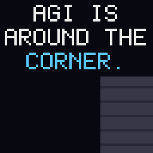
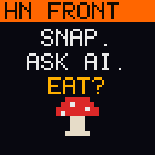
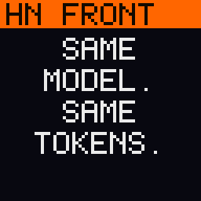
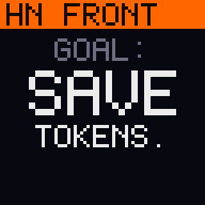
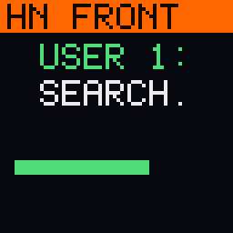
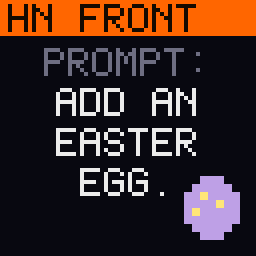

# Founder House Stockholm: GIF approval

Tick `Approved` for each GIF that can go on the backpack; leave a note under any that needs changes.
Storyboards: [README.md](README.md).

Removed in review: `fika-quiz`, `hiscore`, `next`, `savefile`, `hn-quant`, `hn-hotlap`

| # | Scene | Playlist |
| - | ----- | -------- |
| 1 | [`grep`](#1-grep) | - |
| 2 | [`inside`](#2-inside) | - |
| 3 | [`lagom`](#3-lagom) | - |
| 4 | [`taste`](#4-taste) | - |
| 5 | [`truth`](#5-truth) | - |
| 6 | [`kanelbulle`](#6-kanelbulle) | - |
| 7 | [`proceed`](#7-proceed) | - |
| 8 | [`interview`](#8-interview) | - |
| 9 | [`mining`](#9-mining) | - |
| 10 | [`sandbox`](#10-sandbox) | - |
| 11 | [`gpu-poor`](#11-gpu-poor) | main |
| 12 | [`agi-1gw`](#12-agi-1gw) | main |
| 13 | [`hn-cities`](#13-hn-cities) | main |
| 14 | [`hn-rtk`](#14-hn-rtk) | main |
| 15 | [`hn-mushroom`](#15-hn-mushroom) | - |
| 16 | [`hn-pricing`](#16-hn-pricing) | main |
| 17 | [`hn-burned`](#17-hn-burned) | main |
| 18 | [`hn-backdoor`](#18-hn-backdoor) | - |
| 19 | [`hn-otel`](#19-hn-otel) | - |
| 20 | [`hn-egg`](#20-hn-egg) | - |
| 21 | [`hn-compile`](#21-hn-compile) | main |
| 22 | [`hn-tau`](#22-hn-tau) | main |

## 1. grep

Playlist: none. Loop: 28 s.

- [ ] Approved

Notes: Fixed after review: dropped the "$ grep -c yours / 0? / ASK ME." beat; guide card now reads ANTHROPIC / EVALS / GUIDE:. Needs re-approval.

## 2. inside

Playlist: none. Loop: 65 s.

- [ ] Approved

Notes:

## 3. lagom

Playlist: none. Loop: 27 s.

- [ ] Approved

Notes:

## 4. taste

Playlist: none. Loop: 28 s.

- [ ] Approved

Notes:

## 5. truth

Playlist: none. Loop: 28 s.

- [ ] Approved

Notes:

## 6. kanelbulle

Playlist: none. Loop: 27 s.

- [ ] Approved

Notes:

## 7. proceed

Playlist: none. Loop: 27 s.

- [ ] Approved

Notes:

## 8. interview

Playlist: none. Loop: 27 s.

- [ ] Approved

Notes:

## 9. mining

Playlist: none. Loop: 32 s.

- [ ] Approved

Notes:

## 10. sandbox

Playlist: none. Loop: 43 s.

- [ ] Approved

Notes:

## 11. gpu-poor

Playlist: `main`. Loop: 29 s.

- [x] Approved

Notes:

## 12. agi-1gw

Playlist: `main`. Loop: 41 s.

- [x] Approved

Notes:

## 13. hn-cities

Playlist: `main`. Loop: 56 s.

- [x] Approved

Notes:

## 14. hn-rtk

Playlist: `main`. Loop: 55 s.

- [x] Approved

Notes:

## 15. hn-mushroom

Playlist: none. Loop: 55 s.

- [x] Approved

Notes:

## 16. hn-pricing

Playlist: `main`. Loop: 54 s.

- [x] Approved

Notes:

## 17. hn-burned

Playlist: `main`. Loop: 56 s.

- [x] Approved

Notes:

## 18. hn-backdoor

Playlist: none. Loop: 62 s.

- [x] Approved

Notes:

## 19. hn-otel

Playlist: none. Loop: 52 s.

- [x] Approved

Notes:

## 20. hn-egg

Playlist: none. Loop: 49 s.

- [x] Approved

Notes:

## 21. hn-compile

Playlist: `main`. Loop: 51 s.

- [x] Approved

Notes:

## 22. hn-tau

Playlist: `main`. Loop: 52 s.

- [x] Approved

Notes:
