# Claude Founder House Stockholm: backpack scenes

Event: [Stockholm | Claude Founder House: Founder Cohort](https://luma.com/h827z89v), hosted by Anthropic, Wed 14 Oct 2026, 08:30-13:00 CEST, Södermalm. Audience: founders and CEOs of Nordic AI-native companies. The morning is livestreamed.

Goal: promote [Your agent session transcripts are precious, keep them](https://quesma.com/blog/agent-session-transcripts-are-precious/) without a sales pitch. The backpack plays a fellow attendee taking notes on the talks; every scene ends with "talk to my human". The badge already says Quesma, so the screen shows no URL, QR code or product name.

Rules from the interview:
- Snarky and nerdy, never offending a person or company. Speakers and panel companies are not named on screen.
- Anthropic appears only as a compliment (200k transcripts, "Read the transcripts!"). Nothing about deletion bugs, valuations or rivalries.
- A sprinkle of Swedish: FIKA, HEJ, LAGOM, FRÅGOR, TACK SÅ MYCKET, MINGEL, JA, JÄTTEBRA, MER FIKA.
- Slow: text cards stay up 5.5-7 s, animation steps about 0.8 s. The device honours GIF frame durations (checked with a 3000 ms / 300 ms calibration loop).

```bash
uv run scripts/founder_house_stockholm.py --list       # playlists, loop length, chunks
uv run scripts/founder_house_stockholm.py mingel       # send a playlist (or a single scene name)
uv run scripts/founder_house_stockholm.py --preview    # regenerate the scene GIFs below
```

Previews are upscaled 4x; the device gets the 64x64 version. A playlist loops on the backpack until the next upload. Each upload is 112-143 chunks (limit 255), about a minute over Bluetooth.

## Playlists

Slot times are not published, so playlists are switched by hand.

| Playlist | Play during | Scenes | Loop | Chunks |
|---|---|---|---|---|
| `mingel` | Arrival coffee before 08:30, networking, walking, after 13:00 | fika-quiz, proceed, kanelbulle, interview, mining, savefile | 3:03 | 143 |
| `talks` | Keynote "Anthropic on where Claude goes next" and "How we use Claude inside Anthropic" | next, grep, hiscore, savefile | 2:17 | 112 |
| `panel` | "Founder panels: on building product, teams, and margins around AI" and office hours | lagom, taste, truth, kanelbulle, mining | 2:23 | 129 |

## fika-quiz (40 s)

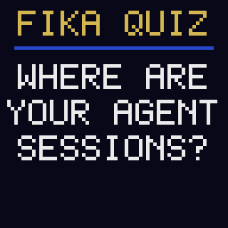

A quiz show that makes people answer out loud. The lifeline is a fika with the man wearing the backpack.

1. `FIKA QUIZ` / `WHERE ARE` / `YOUR AGENT` / `SESSIONS?`
2. Answers appear one by one: `A: GIT`, `B: S3`, `C: LAPTOP`, `D: NO IDEA`
3. `FINAL` / `ANSWER?`, then D locks in
4. `LIFELINE:` / `FIKA WITH` / `MY HUMAN.` then `TAP MY` / `SHOULDER.`

Hallway:
- They say: "D. Definitely D."
- Jacek: "Everyone says D. You keep the code in git and the session that wrote it goes to /dev/null. Anthropic analyzed 200,000 of its own Claude Code transcripts. What would you find in yours?"

## next (48 s)

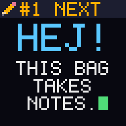

Riffs on the keynote: more power is coming, at a higher cost. Source: [Karpathy, 11 Oct 2026](https://x.com/karpathy/status/2109361546505966046) estimates "~5,000 people (~0.00006%) with access to frontier-grade systems internally".

1. `#1 NEXT` header, `HEJ!` / `THIS BAG` / `TAKES` / `NOTES.`
2. `WHERE IS` / `CLAUDE` / `GOING?`
3. `KARPATHY:` / `~5000` / `HAVE THE` / `FRONTIER.`
4. `NEXT:` / `YOU TOO.` with a POWER bar and a COST bar; the cost bar outruns the power bar and blinks red
5. `PAYING FOR` / `POWER?`, a page falls into a pit: `/dev/null`
6. `KEEP THE` / `RECEIPTS.`
7. `TALK TO` / `MY HUMAN.` / `HEJ HEJ!`

Hallway:
- They say: "So I'll pay for superintelligence and throw away the receipts?"
- Jacek: "Karpathy says about 5,000 people have frontier-grade systems today. You'll get that power too, and you'll pay for it. Transcripts are proof of work for the tokens you paid for, and lessons you will pay to relearn."

## grep (35 s)

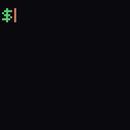

A terminal counts up to 200,000, credits Anthropic, quotes its evals guide, then turns the grep on the reader.

1. `$ grep -c` / `transcript` typed out
2. Counter: `000042`, `001337`, `008192`, `031415`, `065536`, `131072`, `199999`, `200000`
3. `ANTHROPIC` / `200K` / `OF ITS OWN` / `SESSIONS,` / `ANALYZED.`
4. `ITS EVALS` / `GUIDE:` / `READ THE` / `TRAN-` / `SCRIPTS!`
5. `$ grep -c` / `yours` / `0?` / `ASK ME.`

Hallway:
- They say: "Mine's definitely zero."
- Jacek: "Everyone's is. Anthropic analyzed 200,000 of its own Claude Code transcripts, and its evals guide ends with 'Read the transcripts!' Your taste, encoded as evals, is your edge. Are you keeping the raw material?"

## hiscore (25 s)

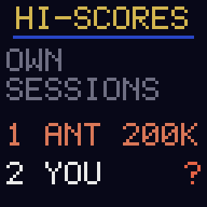

An arcade high-score table: Anthropic first, the reader second with a blinking question mark.

1. `HI-SCORES` / `OWN` / `SESSIONS` / `1 ANT 200K` / `2 YOU ?`
2. `1ST PLACE:` / `JÄTTEBRA!`
3. `PLAYER 2` / `READY?` / blinking `PRESS` / `SAVE` / `SESSIONS`
4. `TALK TO` / `MY HUMAN.` / `NEW GAME?`

Hallway:
- They say: "What's my score?"
- Jacek: "Depends: how many of your sessions can you still open? Anthropic analyzed 200,000 of its own."

## savefile (30 s)

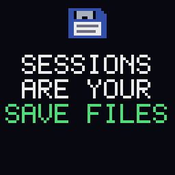

Sessions as game saves; without them you replay the level.

1. Floppy disk, `SESSIONS` / `ARE YOUR` / `SAVE FILES`
2. `AUTOSAVE:` / blinking `OFF`
3. `GAME OVER.` / `LESSONS TO` / `RELEARN.`
4. `CONTINUE?` with a big countdown 9, 8, 7, 6, 5
5. `TALK TO` / `MY HUMAN.` / `PLAYER 2?`

Hallway:
- They say: "My agent has no save files."
- Jacek: "Then every lesson it paid for, you'll pay to relearn. The transcripts are the save files."

## lagom (28 s)

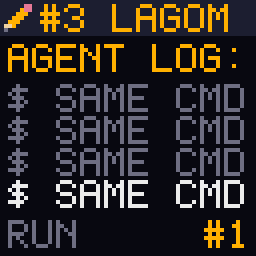

A log of the same command scrolling up to run #339. The task still passed, at about 9x the cost. The punchline is Swedish. No line comments on a panelist or on pricing.

1. `#3 LAGOM` header, `AGENT LOG:`, `$ SAME CMD` scrolling, `RUN #1` to `#339`
2. `TASK:` / `PASSED.` / `COST:` / `ABOUT 9X.`
3. `339 IS` / `NOT LAGOM.` with a Swedish flag
4. `TALK TO` / `MY HUMAN.` / `NO LOOPS.`

Hallway:
- They say: "339 identical commands? Not a real number."
- Jacek: "Real. 339 identical commands over 12 minutes, the task still passed, about 9x the cost. A green test won't show you that; the transcript does."

## taste (28 s)

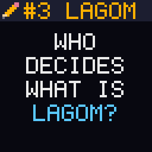

For the panel on building product and teams: who decides what good looks like?

1. `WHO` / `DECIDES` / `WHAT IS` / `LAGOM?`
2. A gauge (red, green, red) whose needle swings slowly, `HMM...`, then settles in the green: `LAGOM`
3. `YOUR TASTE` / `ENCODED AS` / `EVALS, IS` / `YOUR EDGE.`
4. `TALK TO` / `MY HUMAN.` / `ASK HOW.`

Hallway:
- They say: "How do you encode taste?"
- Jacek: "From your transcripts: the moments you corrected the agent are your taste. Turn those into evals."

## truth (28 s)

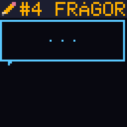

A two-bubble chat with the classic support question and the agent-era answer. The note is an X-Files nod, with a small UFO.

1. `#4 FRÅGOR` header, bubble: `STEPS TO` / `REPRODUCE?`
2. Reply bubble: `IT WORKED` / `ON MY` / `AGENT.`
3. `THE TRUTH` / `IS IN THE` / `TRANSCRIPT`, UFO with a tractor beam
4. `TALK TO` / `MY HUMAN.` / `HE GREPS.`

Hallway:
- They say: "'It worked on my agent' is painfully accurate."
- Jacek: "The first question in any debugging chat is 'can you show me what it did?' The truth is in the transcript, if you kept it."

## kanelbulle (27 s)

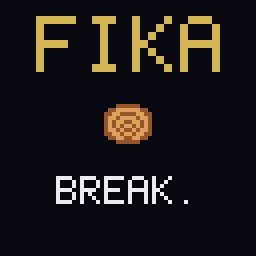

You take a fika; the agent keeps coding. The cinnamon bun disappears bite by bite while the file count climbs.

1. `FIKA` / cinnamon bun / `BREAK.`
2. `YOU: FIKA.` / `AGENT:` / `3 FILES` to `47 FILES` / `CHANGED.`, one bite per step
3. Crumbs, `WHAT DID` / `IT DO?` / `ASK THE` / `TRANSCRIPT`
4. `TALK TO` / `MY HUMAN.` / `MER FIKA?`

Hallway:
- They say: "That's literally my morning."
- Jacek: "And the diff tells you what changed, not why. The why is in the session."

## proceed (27 s)

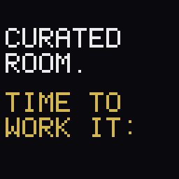

The networking slot becomes a Claude Code style permission prompt. The selector picks "always", so "talk to me" is said in tool-approval language.

1. `CURATED` / `ROOM.` / `TIME TO` / `WORK IT:` (from the agenda line)
2. `FIKA 1:1` / `PROCEED?` / `1. YES` / `2. ALWAYS` / `3. NO`, selector moves to 2, Enter
3. `1:1` / `APPROVED`, spinner `FIKAING..`
4. `TACK SÅ` / `MYCKET!` / `TAP MY` / `SHOULDER.`

Hallway:
- They tap his shoulder: "I pick option 2."
- Jacek: "Approved, no more prompts. So: when your agent did something weird last week, could you still open the transcript?"

## interview (27 s)

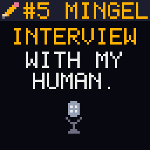

The backpack interviews its wearer, in Jacek's own words.

1. `#5 MINGEL` header, `INTERVIEW` / `WITH MY` / `HUMAN.` with a mic
2. `Q: BEFORE?` / `10 YEARS` / `GREPPING` / `LOGS TILL` / `NASDAQ IPO`
3. `Q: NOW?` / `MINING` / `SILVER OUT` / `OF AGENT` / `SESSIONS.` with a glint running across SILVER
4. `Q: CAN I` / `ASK HIM?` / `JA! TAP` / `HIS` / `SHOULDER.`

Hallway:
- They say: "Mining silver out of agent sessions? Explain."
- Jacek: "Ten years grepping logs at Sumo Logic. Raw agent transcripts are the new logs: that's bronze. Clean them and they're silver. Your taste, encoded as evals, is your edge: that's the gold."

## mining (32 s)

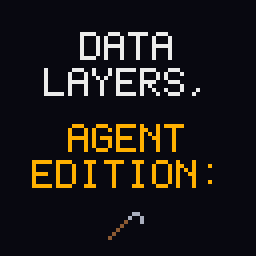

The bronze/silver/gold data layers, agent edition. Pairs with the interview's "mining silver".

1. `DATA` / `LAYERS,` / `AGENT` / `EDITION:` with a swinging pickaxe
2. Pickaxe strikes a bronze nugget: `BRONZE:` / `RAW` / `SESSIONS`
3. Silver nugget: `SILVER:` / `CLEANED,` / `SEARCHABLE`
4. Gold nugget: `GOLD:` / `YOUR TASTE` / `AS EVALS.`
5. `TALK TO` / `MY HUMAN.` / `HE DIGS.`

Hallway:
- They say: "What's the gold?"
- Jacek: "Your taste, encoded as evals. Everyone has the same models; nobody else has your sessions."

## Not used

- A Dala horse interviewing Jacek
- `JÄTTEBRA` as a separate Swedish praise scene (folded into hiscore)

## Sources

- Event: [luma.com/h827z89v](https://luma.com/h827z89v), [anthropic.com/events/claude-founder-house-stockholm](https://www.anthropic.com/events/claude-founder-house-stockholm)
- Stats and quotes (200k transcripts, "Read the transcripts!", 339 commands at about 9x cost, proof of work for tokens, lessons you will pay to relearn, taste encoded as evals): [Quesma blog](https://quesma.com/blog/agent-session-transcripts-are-precious/)
- ~5,000 insiders: [Karpathy on X, 11 Oct 2026](https://x.com/karpathy/status/2109361546505966046)
