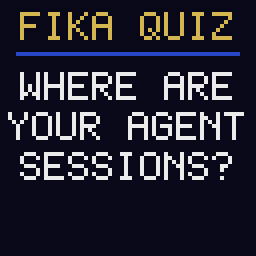
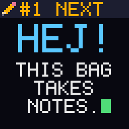
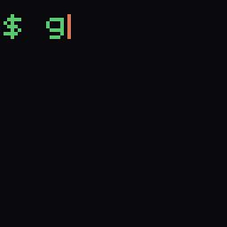
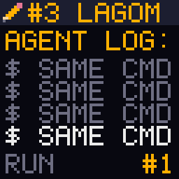
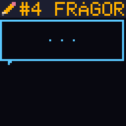
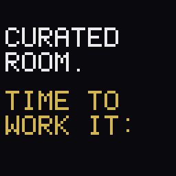
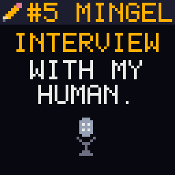

# Claude Founder House Stockholm: backpack scenes

Event: [Stockholm | Claude Founder House: Founder Cohort](https://luma.com/h827z89v), hosted by Anthropic, Wed 14 Oct 2026, 08:30-13:00 CEST, Södermalm. Audience: founders and CEOs of Nordic AI-native companies. The morning is livestreamed.

Goal: promote [Your agent session transcripts are precious, keep them](https://quesma.com/blog/agent-session-transcripts-are-precious/) without a sales pitch. The backpack plays a fellow attendee taking notes on the talks; every scene ends with "talk to my human". The badge already says Quesma, so the screen shows no URL, QR code or product name.

Rules from the interview:
- Snarky and nerdy, never offending a person or company. Speakers and panel companies are not named on screen.
- Anthropic appears only as a compliment (200k transcripts, "Read the transcripts!"). Nothing about deletion bugs, valuations or rivalries.
- A sprinkle of Swedish: FIKA, HEJ, LAGOM, FRÅGOR, TACK SÅ MYCKET, MINGEL, JA.

```bash
uv run scripts/founder_house_stockholm.py --list       # scenes and when to play them
uv run scripts/founder_house_stockholm.py truth        # send one scene (name or number)
uv run scripts/founder_house_stockholm.py --preview    # regenerate the GIFs below
```

Previews are upscaled 4x; the device gets the 64x64 version. Each scene loops on the backpack until the next upload.

## Day plan

Slot times are not published, so scenes are picked by hand as the morning goes.

| # | Scene | Play during | Loop | Chunks |
|---|---|---|---|---|
| 0 | `fika-quiz` | Arrival coffee before 08:30, any lull | 8.4 s | 21 |
| 1 | `next` | Keynote: "Anthropic on where Claude goes next" | 14.5 s | 31 |
| 2 | `grep` | "How we use Claude inside Anthropic" (upload after it starts) | 8.3 s | 20 |
| 3 | `lagom` | "Founder panels: on building product, teams, and margins around AI" | 7.8 s | 29 |
| 4 | `truth` | "Problem-solving": office hours with Applied AI | 8.9 s | 16 |
| 5 | `proceed` | "Networking: a curated room with time built in to work it" | 6.2 s | 18 |
| 6 | `interview` | Evergreen default: walking, between slots, after 13:00 | 10.1 s | 19 |

## 0. FIKA QUIZ



A quiz show that makes people answer out loud. The lifeline is a fika with the man wearing the backpack.

1. `FIKA QUIZ` / `WHERE ARE` / `YOUR AGENT` / `SESSIONS?`
2. Answers appear one by one: `A: GIT`, `B: S3`, `C: LAPTOP`, `D: NO IDEA`
3. `FINAL` / `ANSWER?`, then D locks in
4. `LIFELINE:` / `FIKA WITH` / `MY HUMAN.` then `TAP MY` / `SHOULDER.`

Hallway:
- They say: "D. Definitely D."
- Jacek: "Everyone says D. You keep the code in git and the session that wrote it goes to /dev/null. Anthropic analyzed 200,000 of its own Claude Code transcripts. What would you find in yours?"

## 1. Where Claude goes next



Riffs on the keynote: more power is coming, at a higher cost. Source: [Karpathy, 11 Oct 2026](https://x.com/karpathy/status/2109361546505966046) estimates "~5,000 people (~0.00006%) with access to frontier-grade systems internally".

1. `#1 NEXT` header, `HEJ!` / `THIS BAG` / `TAKES` / `NOTES.`
2. `WHERE IS` / `CLAUDE` / `GOING?`
3. `KARPATHY:` / `~5000` / `HAVE THE` / `FRONTIER.`
4. `NEXT:` / `YOU TOO.` with a POWER bar and a COST bar; the cost bar outruns the power bar and turns red
5. `PAYING FOR` / `POWER?`, a page falls into a pit: `/dev/null`
6. `KEEP THE` / `RECEIPTS.`
7. `TALK TO` / `MY HUMAN.` / `HEJ HEJ!`

Hallway:
- They say: "So I'll pay for superintelligence and throw away the receipts?"
- Jacek: "Karpathy says about 5,000 people have frontier-grade systems today. You'll get that power too, and you'll pay for it. Transcripts are proof of work for the tokens you paid for, and lessons you will pay to relearn."

## 2. grep 200k



A terminal counts up to 200,000, credits Anthropic, quotes its evals guide, then turns the grep on the reader. Upload it once the talk has started, so it never looks like the backpack knew the playbook in advance.

1. `$ grep -c` / `transcript` typed out
2. Counter: `000042`, `001337`, `008192`, `031415`, `065536`, `131072`, `199999`, `200000`
3. `ANTHROPIC` / `200K` / `OF ITS OWN` / `SESSIONS,` / `ANALYZED.`
4. `ITS EVALS` / `GUIDE:` / `READ THE` / `TRAN-` / `SCRIPTS!`
5. `$ grep -c` / `yours` / `0?` / `ASK ME.`

Hallway:
- They say: "Mine's definitely zero."
- Jacek: "Everyone's is. Anthropic analyzed 200,000 of its own Claude Code transcripts, and its evals guide ends with 'Read the transcripts!' Your taste, encoded as evals, is your edge. Are you keeping the raw material?"

## 3. 339 is not lagom



A log of the same command scrolling up to run #339. The task still passed, at about 9x the cost. The punchline is Swedish. No line comments on a panelist or on pricing.

1. `#3 LAGOM` header, `AGENT LOG:`, `$ SAME CMD` scrolling, `RUN #1` to `#339`
2. `TASK:` / `PASSED.` / `COST:` / `ABOUT 9X.`
3. `339 IS` / `NOT LAGOM.` with a Swedish flag
4. `TALK TO` / `MY HUMAN.` / `NO LOOPS.`

Hallway:
- They say: "339 identical commands? Not a real number."
- Jacek: "Real. 339 identical commands over 12 minutes, the task still passed, about 9x the cost. A green test won't show you that; the transcript does."

## 4. The truth is in the transcript



A two-bubble chat with the classic support question and the agent-era answer. The note is an X-Files nod, with a small UFO.

1. `#4 FRÅGOR` header, bubble: `STEPS TO` / `REPRODUCE?`
2. Reply bubble: `IT WORKED` / `ON MY` / `AGENT.`
3. `THE TRUTH` / `IS IN THE` / `TRANSCRIPT`, UFO with a tractor beam
4. `TALK TO` / `MY HUMAN.` / `HE GREPS.`

Hallway:
- They say: "'It worked on my agent' is painfully accurate."
- Jacek: "The first question in any debugging chat is 'can you show me what it did?' The truth is in the transcript, if you kept it."

## 5. Fika 1:1, proceed?



The networking slot becomes a Claude Code style permission prompt. The selector picks "always", so "talk to me" is said in tool-approval language.

1. `CURATED` / `ROOM.` / `TIME TO` / `WORK IT:` (from the agenda line)
2. `FIKA 1:1` / `PROCEED?` / `1. YES` / `2. ALWAYS` / `3. NO`, selector moves to 2, Enter
3. `1:1` / `APPROVED`, spinner `FIKAING..`
4. `TACK SÅ` / `MYCKET!` / `TAP MY` / `SHOULDER.`

Hallway:
- They tap his shoulder: "I pick option 2."
- Jacek: "Approved, no more prompts. So: when your agent did something weird last week, could you still open the transcript?"

## 6. MINGEL: interview with my human



The default loop. The backpack interviews its wearer, in Jacek's own words.

1. `#5 MINGEL` header, `INTERVIEW` / `WITH MY` / `HUMAN.` with a mic
2. `Q: BEFORE?` / `10 YEARS` / `GREPPING` / `LOGS TILL` / `NASDAQ IPO`
3. `Q: NOW?` / `MINING` / `SILVER OUT` / `OF AGENT` / `SESSIONS.` with a glint running across SILVER
4. `Q: CAN I` / `ASK HIM?` / `JA! TAP` / `HIS` / `SHOULDER.`

Hallway:
- They say: "Mining silver out of agent sessions? Explain."
- Jacek: "Ten years grepping logs at Sumo Logic. Raw agent transcripts are the new logs: that's bronze. Clean them and they're silver. Your taste, encoded as evals, is your edge: that's the gold."

## Not used

- Arcade high-score table: `1 ANT 200K` / `2 YOU ?` with `JÄTTEBRA!`
- A cinnamon bun eaten bite by bite while the agent retries up to #339
- A Dala horse interviewing Jacek; a pickaxe turning bronze ore into a silver nugget
- Spoken line only: "Sessions are your save files."

## Sources

- Event: [luma.com/h827z89v](https://luma.com/h827z89v), [anthropic.com/events/claude-founder-house-stockholm](https://www.anthropic.com/events/claude-founder-house-stockholm)
- Stats and quotes (200k transcripts, "Read the transcripts!", 339 commands at about 9x cost, proof of work for tokens): [Quesma blog](https://quesma.com/blog/agent-session-transcripts-are-precious/)
- ~5,000 insiders: [Karpathy on X, 11 Oct 2026](https://x.com/karpathy/status/2109361546505966046)
